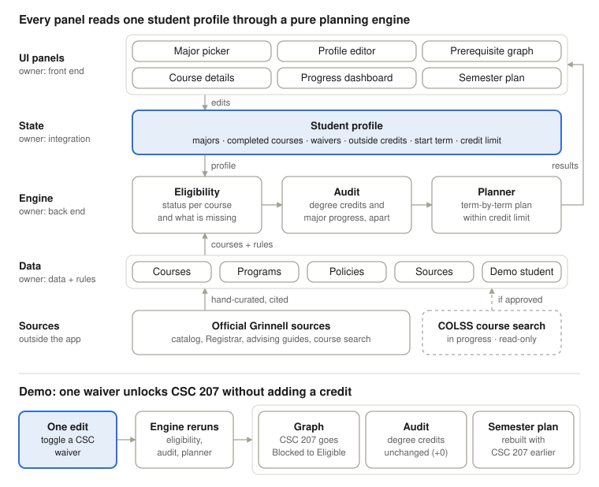
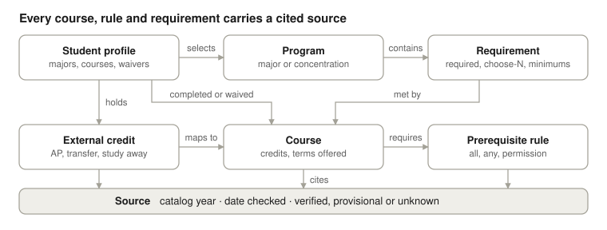

# CourseGraph — High-Level Design

Nov 21, 2026 · Champ-Pacifique Mukiza · [2-page PDF](CourseGraph_High_Level_Design.pdf) · [full spec](CourseGraph_Product_Specification.md)

CourseGraph turns Grinnell's scattered degree rules into one interactive map and a semester plan that recalculates on every change.

**MVP:** CS + Math, cited data, fictional student. **Out of scope:** COLSS login, registration, official audit. **Tracks:** Grinnell, Interdisciplinary, Overall.

**Plan:** flesh out → research COLSS → roles → build → merge → explain. Contracts lock in the first 15% of the time; features freeze for the last 20%.

## Architecture

## Domain model

## Credit rules

One yes never implies another; Unknown never counts; majors commonly need 32–40 credits.

| Source | Clears prereq | Degree credit | Major credit | Dept. cap (48) |
| --- | --- | --- | --- | --- |
| Grinnell course | Yes | Yes | If in major | Counts |
| Placement waiver | Yes | No | No | No |
| AP / IB | If listed | Yes | If labeled | Exempt |
| Transfer | If approved | Limited | After review | Verify |
| Study away | If approved | Yes | After review | Verify |

## Open questions for review

- [ ] Which catalog year does the demo student follow?
- [ ] Which 20–30 CS and Math courses can we verify from official sources?
- [ ] Does COLSS offer an approved read-only data route, or do we ship curated data only?
- [ ] Do we demo AP or study-away credit, or only a waiver?
- [ ] Event deadline, judging format, and which prize tracks we can enter?
