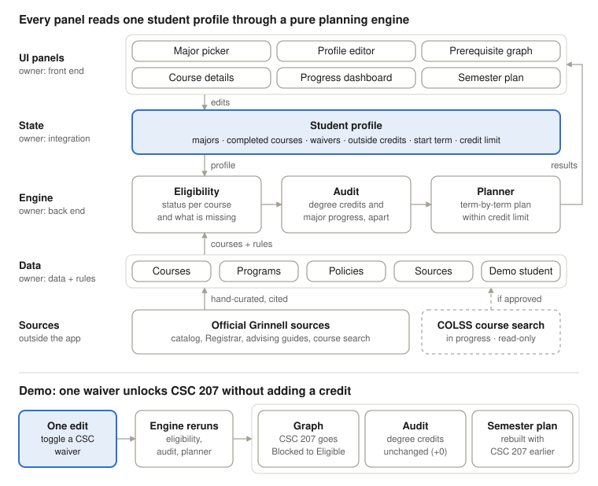
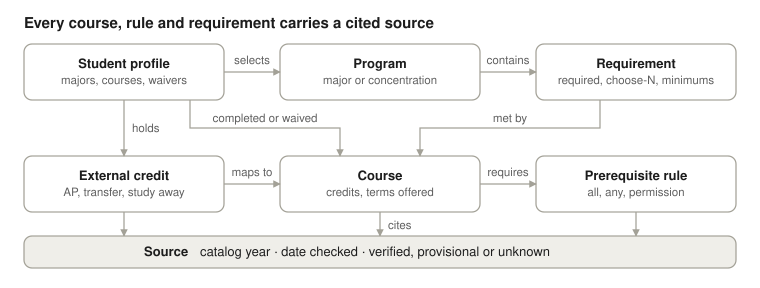
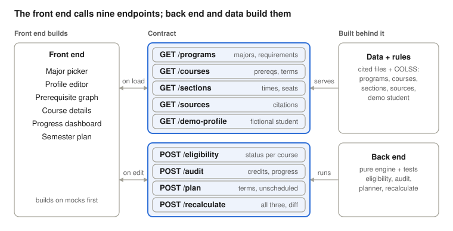
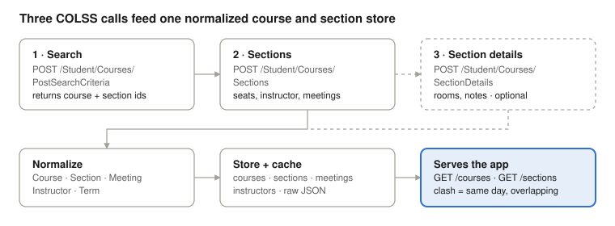

# GrinPath — High-Level Design

Nov 21, 2026 · Champ-Pacifique Mukiza · [PDF](GrinPath_High_Level_Design.pdf) · [full spec](GrinPath_Product_Specification.md)

GrinPath turns Grinnell's scattered degree rules into one interactive map and a semester plan that recalculates on every change.

**MVP:** CS + Math, cited data, fictional student. **Out of scope:** COLSS login, registration, official audit. **Tracks:** Grinnell, Interdisciplinary, Overall.

**Plan:** flesh out → research COLSS → roles → build → merge → explain. Contracts lock in the first 15% of the time; features freeze for the last 20%.

## Architecture

## Domain model

## Endpoints

Nine endpoints are the contract, so front end and back end build in parallel.

| Endpoint | Sends | Used by |
| --- | --- | --- |
| GET /programs | Catalog year | Major picker, progress dashboard |
| GET /courses | Catalog year | Graph, course details, profile editor |
| GET /sections | Term, course | Schedule calendar, catalog |
| GET /sources | Source ids | Course details |
| GET /demo-profile | Nothing | Onboarding credit import |
| POST /eligibility | Profile | Graph, course details |
| POST /audit | Profile | Progress dashboard |
| POST /plan | Profile | Semester plan |
| POST /recalculate | Profile + previous | Every panel, on each edit |

- **Front end** builds the six panels on mock responses and never computes eligibility.
- **Back end** builds POSTs, **data + rules** serves GETs, **integration** swaps out mocks.

## COLSS course data

The backend reads sections, seats and meeting times from three course-search calls on COLSS, Grinnell's Ellucian Self-Service.

- **Status:** calls, fields and data model are documented in `docs/backend/examples`; responses there are captured samples, not live requests yet.
- **Rule:** use the public course search only; no student logins, cookies or records.

## Credit rules

Each answer stands alone; Unknown never counts; majors commonly need 32–40 credits.

| Source | Clears prereq | Degree credit | Major credit | Dept. cap (48) |
| --- | --- | --- | --- | --- |
| Grinnell course | Yes | Yes | If in major | Counts |
| Placement waiver | Yes | No | No | No |
| AP / IB | If listed | Yes | If labeled | Exempt |
| Transfer | If approved | Limited | After review | Verify |
| Study away | If approved | Yes | After review | Verify |

## Open questions for review

- [ ] Which catalog year does the demo student follow?
- [ ] Which 20–30 CS and Math courses can we verify from official sources?
- [ ] Does COLSS offer an approved read-only data route, or do we ship curated data only?
- [ ] Do we demo AP or study-away credit, or only a waiver?
- [ ] Event deadline, judging format, and which prize tracks we can enter?
- [ ] May we call the COLSS course-search endpoints live, or demo from a saved snapshot?

Front-end prototype: [`frontend/`](../frontend/README.md).
